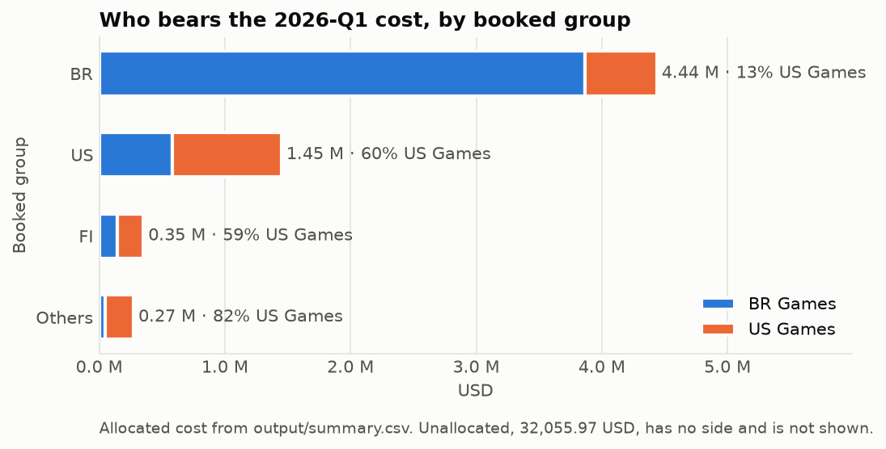
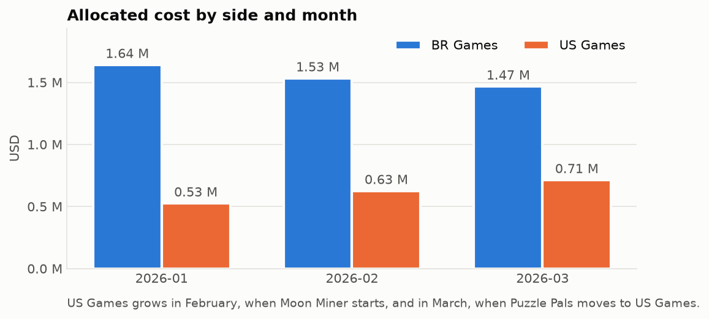

# Lumen Games: Q1 2026 cost allocation

> **Take-home case** for a Data Engineer hiring process at a games company (November 2026). Lumen Games and all the data are fictional; the problem statement is in [`BRIEF.md`](BRIEF.md). Diagrams: [`docs/diagrams/`](docs/diagrams/).

A DuckDB SQL pipeline that puts every in-scope ledger cost of the quarter on a side, BR Games or US Games, by booked
entity and month, with checks that stop the run when a number would be wrong. Written for the Tax team.

## Results

Of the 6,539,250.85 USD in scope, BR Games bears 4,642,414.76 USD (71.0%) and US Games 1,864,780.12 USD (28.5%);
32,055.97 USD (0.5%) is not on a side yet, pending two answers from Tax. The ledger reconciles to the cent in every
month.





The note for the Tax team, with the issues, assumptions and open items: [`docs/tax-note.md`](docs/tax-note.md).

## How to run

Python 3.12, from the repo root:

```bash
python3 -m venv .venv && source .venv/bin/activate
pip install -r requirements.txt
python run.py
```

`run.py` prints each step and check. It exits with 0 when every `block_` check passes and writes `output/`. When a
`block_` check fails, it names the check, exits with 1 and writes only `output/checks.csv` (D04).

The notebooks in `notebooks/` open in VS Code with the `.venv` kernel. Run `python run.py` first: they read
`output/`.

## Outputs

| File | What it holds |
|---|---|
| `output/allocation.csv` | every ledger line, one row per piece: game or bucket, bearing group, side, share, amount, status and reason |
| `output/summary.csv` | amount by booked group × side, for each month and the quarter (BRIEF item 2) |
| `output/summary_by_entity.csv` | the same by booked entity, the view Tax asks for |
| `output/reconciliation.csv` | ledger total = out of scope + allocated + unallocated, for each month and the quarter |
| `output/checks.csv` | each check's result: pass, warn or fail |

Columns, reasons and checks: [`docs/design.md`, Output](docs/design.md#output).

## How it works

`run.py` runs the eleven files in `sql/` in name order: load, clean, classify each line, split direct costs to games
and indirect costs to buckets, take the side from the dated mapping, then build the allocation table, the summaries
and the reconciliation. The checks in `sql/checks/` run last. Python only runs the SQL and writes the files.

- Which file does what, with a diagram: [Pipeline](docs/design.md#pipeline).
- The path of one ledger line, step by step: [How a line is allocated](docs/design.md#how-a-line-is-allocated).

## Main decisions

| ID | Decision |
|---|---|
| D01 | DuckDB SQL, one file per step; a rule change is a change in one file |
| D03, D09 | One allocation table for every ledger line, one row per piece, with a status and a reason |
| D04, D07 | Checks are SQL files; a `block_` check stops the run and leaves no result file, a `warn_` check reports |
| D05 | Amounts kept at full precision and rounded to cents only in the output files |
| Q01 | A cost that can't be placed stays visible as unallocated, with a reason |
| Q04 | Corporate costs are split by the whole company's employees each month |

All decisions and the reasons for them: [`docs/design.md`](docs/design.md). IDs (R01 rules, Q01 open questions, D01
decisions, ...) are explained in its [IDs](docs/design.md#ids) section.

## How it is checked

- **Every run:** seven `block_` checks (duplicate keys, overlapping mapping rows, months outside one quarter, shares
  that don't add up to 1, reconciliation, unmatched game names, incomplete allocated rows) and two `warn_` checks
  (unallocated dollars, cleaned values).
- **Worked examples:** six real lines computed by hand in pandas, compared row by row with the output: 21 of 21 rows
  match ([`notebooks/02-worked-examples.ipynb`](notebooks/02-worked-examples.ipynb)).
- **Scenarios:** 18 changes to a copy of the project, broken data and business requests, each with its expected result
  written first: 18 of 18 as expected ([`notebooks/03-scenarios.ipynb`](notebooks/03-scenarios.ipynb)).
- **Results and look inside:** charts, monthly changes, and any pipeline table to query
  ([`notebooks/04-results.ipynb`](notebooks/04-results.ipynb)).

## Known limits

- **Cents.** Pieces are rounded one by one, so a line's rounded pieces can differ from the line: 148 of the 397 split
  lines, by at most 0.02 USD. Adding up `allocation.csv` gives 6,507,195.13 USD allocated in the quarter, 0.25 USD more
  than `reconciliation.csv`, which adds up at full precision (D05; `notebooks/04-results.ipynb`, Cents).
- **A wrong but valid mapping row is not caught.** If the mapping file gives a game the wrong side, every check still
  passes; only the worked examples check the result of the rules.
- **Two issues are open** until Tax answers: cost center 3999 (17,017.98 USD) and the Finnish Live Games employees
  (15,037.99 USD). See [`docs/data-issues.md`](docs/data-issues.md).
- **Q04 is an assumption.** The other reading moves about 180,980 USD off BR Games and 188,845 USD onto US Games in the
  quarter, and places about 7,865 USD that is now unallocated (S18).

## How it was built

| Phase | What came out | Where |
|---|---|---|
| F1 Understand the request | rules R01–R11, open questions Q01–Q09 | `docs/design.md` |
| F2 Understand the data | input checks C01–C11, data issues I01–I03 | `notebooks/01-explore.ipynb`, `docs/data-issues.md` |
| F3 Design | decisions, output files and checks, line path, worked examples W01–W06 | `docs/design.md`, `notebooks/02-worked-examples.ipynb` |
| F4 Build | eleven SQL steps, nine checks, `run.py`, `output/` | `sql/`, `run.py` |
| F5 Validate | worked examples vs output, dollar impact of each issue, scenarios S01–S18, adversarial review | `notebooks/02`, `notebooks/03`, `docs/data-issues.md` |
| F6 Communicate | data model and pipeline sections, IDs, summary by entity, results notebook, Tax note, README, AI log | `docs/`, `notebooks/04-results.ipynb` |
| F7 Deliver | clean-checkout test, AI session transcript, zip with `.git` | `docs/ai-transcript.txt`, the delivered zip |

AI use, what was kept and what was rejected: [`docs/ai-usage.md`](docs/ai-usage.md).

## Repository map

```
BRIEF.md            the case, as received (read-only)
data/               the input CSVs, as received (read-only)
sql/                one file per pipeline step, run in name order
sql/checks/         one check per file, block_ or warn_
run.py              runs the steps and the checks, writes output/
output/             the results, written only by run.py
notebooks/          exploration, worked examples, scenarios, results (not used by the pipeline)
docs/design.md      rules, data model, open questions, decisions, output, pipeline, validation
docs/data-issues.md the issues found in the inputs, with their dollar impact
docs/tax-note.md    the one-page note to the Tax team
docs/ai-usage.md    how AI was used, with every prompt
docs/ai-transcript.txt  the AI session, as exported
docs/img/           charts written by notebooks/04-results.ipynb
```
