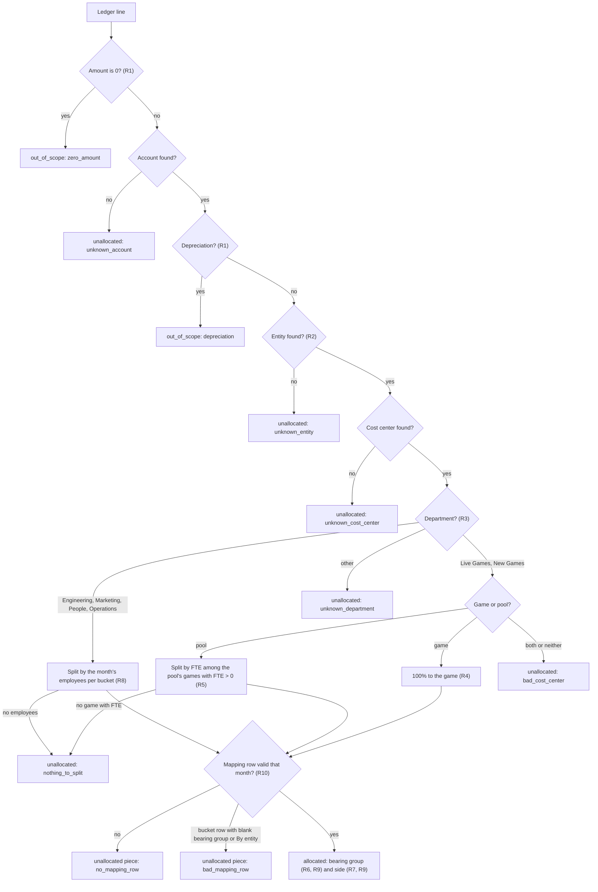

# Design

## Rules

### R1. Scope
- **Rule:** every ledger line is in scope except lines whose account group is Depreciation and lines whose amount is 0. Credits (negative amounts) stay in scope.
- **Check:** in-scope + out-of-scope = all ledger lines, in count and in dollars. Every out-of-scope line is in the output with its reason (depreciation or zero_amount); see Output.

### R2. Booked entity and booked group
- **Rule:** the booked entity is the line's entity. The booked group is that entity's entity_group in entities.csv.
- **Check:** every in-scope line has a booked group.

### R3. Cost type comes from the department
- **Rule:** the cost center's department decides the path. Live Games and New Games are direct. Engineering, Marketing, People and Operations are indirect.
- **Check:** every in-scope line has exactly one cost type, or is unallocated with a reason.

### R4. Direct, single game
- **Rule:** a direct cost center with a game sends 100% of the line to that game.
- **Check:** share = 1 for these lines.

### R5. Direct, pool
- **Rule:** a direct cost center with a pool_id splits the line across the pool's games with fte > 0 in that month. share(game) = fte(game, month) / sum of fte of the pool's games with fte > 0 in that month.
- **Check:** for each line, shares add up to 1. Only games in the pool receive dollars. Games with fte = 0 or no fte that month get nothing.

### R6. Direct, bearing group
- **Rule:** a direct cost does not change entity. Bearing group = booked group.
- **Check:** for every direct row, bearing group = booked group.

### R7. Direct, side
- **Rule:** the side comes from the game's mapping row valid that month (R10). By entity resolves to BR Games when the booked entity is LGB, and to US Games for any other entity.
- **Check:** every direct row ends with BR Games or US Games. By entity never appears in the output.

### R8. Indirect, buckets
- **Rule:** an indirect line is split across buckets by each bucket's share of the month's employees. A bucket is the first word of the employee's category in lower case, an underscore, and the employee's entity group in lower case, e.g. live_br. share(bucket) = employees in bucket that month / all employees of the company that month.
- **Check:** for each month, bucket shares add up to 1. Each indirect line's rows add up to the line's amount.

### R9. Indirect, bearing group and side
- **Rule:** both come from the bucket's mapping row valid that month (R10).
- **Check:** every indirect row has a bearing group and a side.

### R10. Mapping rows have dates
- **Rule:** a mapping row applies to a month when the month's first day is between start_date and end_date, both inclusive.
- **Check (on the inputs, before the join):** for each game or bucket used in a month, exactly one mapping row applies.

### R11. Reconciliation and summary (from "What to deliver", items 2 and 3)
- **Rule:** ledger total = out of scope + allocated + unallocated, for each month and in total. The summary shows the amount by booked group × side, for each month and for the quarter. The quarter is the sum of the months.
- **Check:** the equation holds with abs(difference) < 0.005. Summary total = allocated + unallocated (the in-scope total).

## Open questions

| ID | Question | Assumption I use | Tax note? |
|---|---|---|---|
| Q1 | A line can't be allocated: its account, entity or cost center is missing from its lookup table; its department is not in R3; a direct cost center has both game and pool_id, or neither; a game or bucket has no mapping row valid that month; a pool or month has nothing to split by; a bucket row has a blank bearing group. | Unallocated with a reason; the dollars stay visible. The run continues and warns. An employee whose entity is missing stays in the headcount; their bucket has no mapping row, so that share is unallocated. | yes |
| Q2 | An input table has duplicate keys at the grain the BRIEF states (including both headcount files and line_id in the ledger). | Stop the run: a join would multiply dollars. | if it happens |
| Q3 | Two mapping rows are valid for the same game or bucket and month. | Stop the run: the side is ambiguous. | if it happens |
| Q4 | "The month's employees" for indirect shares: whole company, or only the booking entity's employees? | All employees of the company that month, all entities and both categories. | yes |
| Q5 | A bucket row says By entity. | Does not happen in this data (check 11). If it appears, it is a Q1 case: unallocated with a reason, the run warns. | if it happens |
| Q6 | Credits are split with the same shares, so destinations get negative amounts. | Yes, same shares; credits are not netted before allocating. | no |
| Q7 | Rounding: when to round to cents. | Keep full precision; round only in the output files. Reconciliation passes when abs(difference) < 0.005. | no |
| Q8 | Text keys that almost match (spaces). | Trim only the name columns used to match tables or compared to a rule's value (`account_group`); the run log lists every value changed. | yes, as an issue |
| Q9 | Is the quarter exactly the months in the ledger? | Yes. The ledger covers 2026-01 to 2026-03, the first quarter of 2026 (check 11). The pipeline keeps the check. | no |

## Decisions

| # | Decision | Why |
|---|---|---|
| 1 | **DuckDB SQL** for the pipeline. Python only runs the SQL, the checks and the output; it never changes the data. | The rules are joins and sums, and SQL reads close to them. |
| 2 | **One SQL file per step** in `sql/`, run in name order by `run.py`. | A rule change is a change in one file. |
| 3 | **One allocation table for every ledger line**, with `status` (allocated, unallocated, out_of_scope) and `reason`. | Every dollar is in one place; the reconciliation is one sum by status. |
| 4 | **A blocking check stops the run**: it exits with an error and deletes `allocation.csv`, `summary.csv` and `reconciliation.csv`. `checks.csv` is always written to `output/`. If a step stops with an error, `output/` is left empty. | No wrong or stale number stays in `output/`. |
| 5 | **Line amounts are read as `DECIMAL(18, 2)`; shares are DOUBLE.** A piece (amount × share) keeps full precision and is cast to `DECIMAL(18, 2)` only when written; the checks compare at full precision with the Q7 tolerance. A line's rounded pieces may differ from the line by a few cents (at most 0.02 in this data); that is accepted, not adjusted, and the README says so. All files are read as text and cast explicitly in the load step. Output is sorted by `line_id`, then game or bucket. | Exact amounts in, cents out; the same input always gives the same file, so a change shows as a clean diff. |
| 6 | **No test framework.** | The checks run with every run; worked examples are compared once in F5. |
| 7 | **Checks are SQL queries in `sql/checks/`**, one per file, each returning the failing rows. The file name starts with `block_` or `warn_`. If a failure means the numbers would be wrong or ambiguous (a key or mapping is duplicated, the months are not one quarter, the pipeline lost or created dollars), it blocks. If the dollars are kept but some have no destination, or a value was cleaned, it warns. | The level is visible in the file name; adding a check is adding a file. |
| 8 | **The cleaning step trims names in SQL** and keeps a table of every value it changed (before, after). A `warn_` check reports it (Q8). | No value changes silently. |

Notes:
- The allocation table has one row per piece of a ledger line. A game or bucket with no mapping row is a piece with
  status `unallocated` and its game or bucket filled (the `live_fi` case). Only a line that can't be split at all has
  one row with no game or bucket.
- A missing entity group becomes `unknown` in the bucket name (`live_unknown`, `new_unknown`); that bucket has no
  mapping row, so its piece is unallocated with reason `no_mapping_row`.
- Every row has a share; a line that isn't split has one row with share 1. So the shares of every line add up to 1,
  and its rows add up to its amount.
- The summary leaves out `out_of_scope` and shows `Unallocated` next to BR Games and US Games, by booked group, for
  each month and the quarter.
- Checks and their levels are listed under Output, `checks.csv`.
- The notebooks are exploration and worked examples; the pipeline doesn't use them.

## Output

`python run.py` writes four files to `output/`. On a blocking check, only `checks.csv` is written and the other three
are deleted (decision 4).

### allocation.csv

One row per piece of a ledger line (see Notes under Decisions). Sorted by `line_id`, then `game_or_bucket`.

| Column | What it is |
|---|---|
| `line_id`, `month` | from the ledger |
| `booked_entity`, `booked_group` | the line's entity and its `entity_group` (R2) |
| `account`, `account_name`, `account_group` | from `accounts.csv` |
| `cost_center`, `cost_center_name`, `department`, `pool_id` | from `cost_centers.csv` |
| `cost_type` | `direct` or `indirect`, from the department (R3) |
| `game_or_bucket` | the game (R4, R5), or the bucket for indirect costs (R8) |
| `bearing_group` | the booked group for direct costs (R6); the bucket's mapping row for indirect costs (R9) |
| `side` | `BR Games` or `US Games`; `By entity` is already resolved (R7, R9) |
| `share` | the piece's share of the line; 1 when the line isn't split |
| `amount_usd` | line amount × share, rounded to cents |
| `status` | `allocated`, `unallocated` or `out_of_scope` |
| `reason` | empty when allocated; otherwise one code from the table below |

Lookup columns (names, `booked_group`, `department`, `pool_id`, `cost_type`, `account_group`) are filled whenever the
lookup finds a match, whatever the status. `bearing_group` and `side` are filled only on allocated rows. For example,
L00169 (cost center 3999) has no `cost_center_name`, `department`, `cost_type` or game.

**Reasons.** The steps run in this order, and the first one that fails gives the reason. One code per Q1 case.

| Code | Status | When |
|---|---|---|
| `zero_amount` | out_of_scope | amount is 0 (R1) |
| `unknown_account` | unallocated | account not in `accounts.csv`, so the scope can't be decided |
| `depreciation` | out_of_scope | account group is Depreciation (R1) |
| `unknown_entity` | unallocated | entity not in `entities.csv` |
| `unknown_cost_center` | unallocated | cost center not in `cost_centers.csv` (D1) |
| `unknown_department` | unallocated | department not in R3 |
| `bad_cost_center` | unallocated | a direct cost center has both a game and a pool, or neither |
| `nothing_to_split` | unallocated | a pool has no game with FTE that month (R5), or the month has no employees (R8) |
| `no_mapping_row` | unallocated | a game or bucket has no mapping row valid that month (R10, D3) |
| `bad_mapping_row` | unallocated | a bucket row has a blank bearing group, or says By entity (Q5) |

The last two apply to one piece, not to the whole line: the other pieces of the line are still allocated.

### summary.csv

One row per period × booked group: `period, booked_group, br_games, us_games, unallocated, total`. Period is `2026-01`,
`2026-02`, `2026-03` or `2026-Q1`; the quarter is the sum of the months. `total` is the in-scope amount;
out-of-scope lines are left out.
The month and quarter labels in `summary.csv` and `reconciliation.csv` are built from the ledger's months, not
written in the code.

### reconciliation.csv

One row per period: `period, ledger_total, out_of_scope, in_scope, allocated, unallocated, difference`, where
`difference = ledger_total − out_of_scope − allocated − unallocated`, at full precision (Q7). This is where "every
in-scope dollar" is accounted for. `in_scope` = `ledger_total` − `out_of_scope`, so lines with `unknown_account` count
as in scope (unallocated).

### checks.csv

One row per check: `check, level, result, rows, amount_usd`. `result` is `pass`, `warn` or `fail`: `warn` means a
`warn_` check found rows, and `fail` is used only for `block_` checks, so it always means the run stopped. `rows` and
`amount_usd` describe the rows found; `amount_usd` is empty when the check is not about dollars (duplicate keys,
overlapping mapping, months, trimmed values). `run.py` prints all rows found by `warn_trimmed_values` (Q8), and the
first 10 rows found by any other check.

| Check | Level | Fails when | From |
|---|---|---|---|
| `block_duplicate_keys` | block | an input table has duplicate keys at its grain | Q2 |
| `block_overlapping_mapping` | block | two mapping rows are valid for the same game or bucket and month | Q3 |
| `block_months_outside_quarter` | block | the ledger months are not the three months of one calendar quarter | Q9 |
| `block_shares_not_one` | block | the shares of a line don't add up to 1 | R4, Notes |
| `block_reconciliation` | block | `difference` is not under 0.005, or a summary `total` differs from `in_scope` | R1, R11 |
| `block_allocated_rows_complete` | block | an allocated row has no game or bucket; has a side other than BR Games or US Games (so By entity never reaches the output); is a direct row whose bearing group isn't its booked group; is a pool piece whose game isn't in that pool; or is an indirect row with no bearing group | R5, R6, R7, R9 |
| `warn_unallocated` | warn | any row is unallocated | Q1 |
| `warn_trimmed_values` | warn | the cleaning step changed any value | Q8 |

Dates are cast explicitly in the load step, so a date DuckDB can't read stops the run with an error. A date without
leading zeros (`2026-3-1`) is read as the same day and does not stop the run.

Expected on this data: every `block_` check passes; both `warn_` checks give `warn` (D1 and D3 for unallocated, D2
for trimmed values).

## How a line is allocated

Each ledger line follows this path. The first step that fails gives the line its status and reason (see Output). The
last two failures apply to one piece only: the other pieces of the line are still allocated.

## Worked examples

Real lines from the data, computed independently of the pipeline in
[`notebooks/02-worked-examples.ipynb`](../notebooks/02-worked-examples.ipynb). The pipeline must give the same rows
(compared in F5).

**1. Direct, single game.** L00105, 2026-01, LGB, Salaries, cost center 1001 Star Racer, 103,255.10.
The cost center has a game, so the share is 1 (R4). The mapping row is `Star Racer ` with a trailing space (D2); after
the trim it matches (`01-explore`, check 8). Bearing group = booked group = BR (R6).

| Game | Share | Amount | Bearing group | Side |
|---|---|---|---|---|
| Star Racer | 1 | 103,255.10 | BR | BR Games |

**2. Direct, pool.** L00054, 2026-01, LGB, Salaries, cost center 2010 New Games Prototyping, pool NEW_SHARED,
21,972.14. Moon Miner is in the pool but has no FTE in January, so it gets nothing (R5). FTE of the others: 11.5 + 14.5
+ 9 + 6 = 41. Puzzle Pals is still BR Games in January.

| Game | Share | Amount | Bearing group | Side |
|---|---|---|---|---|
| Pixel Farm | 14.5 / 41 | 7,770.63 | BR | US Games |
| Puzzle Pals | 11.5 / 41 | 6,162.92 | BR | BR Games |
| Rune Quest | 9 / 41 | 4,823.15 | BR | US Games |
| Tiny Chef | 6 / 41 | 3,215.44 | BR | BR Games |
| **Total** | 1 | **21,972.14** | | |

The bearing group stays BR on the US Games rows: a direct cost doesn't change entity (R6).

**3. Indirect.** L00444, 2026-02, LGB, Salaries, cost center 3301 Finance, 21,346.02. The company has 123 employees in
February (R8, Q4).

| Bucket | Share | Amount | Bearing group | Side |
|---|---|---|---|---|
| live_br | 71 / 123 | 12,321.69 | BR | BR Games |
| new_br | 25 / 123 | 4,338.62 | BR | BR Games |
| new_fi | 8 / 123 | 1,388.36 | FI | US Games |
| new_others | 5 / 123 | 867.72 | Others | US Games |
| new_us | 14 / 123 | 2,429.63 | US | US Games |
| **Total** | 1 | **21,346.02** | | |

**4. By entity.** Legacy Arcade (cost center 1004) maps to By entity (R7). Same game and month, two entities:

| Line | Entity | Amount | Bearing group | Side |
|---|---|---|---|---|
| L00334, 2026-01, Salaries | LGB | 24,203.53 | BR | BR Games |
| L00336, 2026-01, Salaries | LGI | 12,825.36 | US | US Games |

**5. Mapping dates.** Puzzle Pals (cost center 2001) moves from BR Games to US Games on 2026-03-01 (R10). Same entity
and account, two months:

| Line | Month | Amount | Bearing group | Side |
|---|---|---|---|---|
| L00114, LGB, Salaries | 2026-02 | 31,929.39 | BR | BR Games |
| L00494, LGB, Salaries | 2026-03 | 32,256.22 | BR | US Games |

The bearing group stays BR: only the side changes.

**6. Unallocated.** Two cases, one per level:
- **Whole line (D1).** L00169, 2026-02, LGB, Professional Services, cost center 3999, 17,017.98. The cost center isn't
  in `cost_centers.csv`, so the line has one row: share 1, no game, status `unallocated`, reason `unknown_cost_center`.
- **One piece (D3).** L00234, 2026-03, LGB, Salaries, cost center 3301 Finance, 24,080.73. There are 125 employees in
  March, 2 of them in live_fi, which has no mapping row.

| Bucket | Share | Amount | Bearing group | Side | Status |
|---|---|---|---|---|---|
| live_br | 70 / 125 | 13,485.21 | BR | BR Games | allocated |
| live_fi | 2 / 125 | 385.29 | | | unallocated, `no_mapping_row` |
| new_br | 26 / 125 | 5,008.79 | BR | BR Games | allocated |
| new_fi | 8 / 125 | 1,541.17 | FI | US Games | allocated |
| new_others | 5 / 125 | 963.23 | Others | US Games | allocated |
| new_us | 14 / 125 | 2,697.04 | US | US Games | allocated |
| **Total** | 1 | **24,080.73** | | | |
